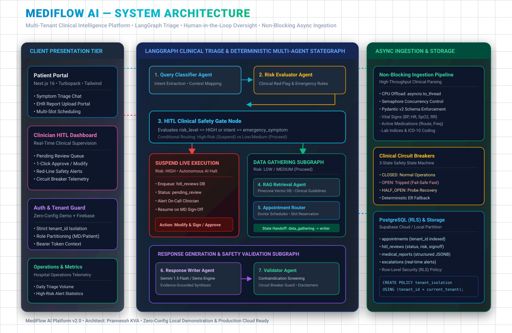

# MediFlow AI

<p align="center">
  <strong>Clinical Intelligence Platform with Human-in-the-Loop (HITL) Oversight</strong>
</p>

<p align="center">
  
  
  
  
  
  
</p>

---

## Executive Overview

**MediFlow AI** is a production-grade clinical intelligence and triage automation platform built with **LangGraph**, **FastAPI (asyncio)**, and **Next.js 16**. It bridges autonomous clinical decision support with safety-first clinical governance:

1. **Multi-Tenant Clinical Triage Workflow in LangGraph**: Enforces strict tenant data isolation (`tenant_id`), partitioned state management, and deterministic multi-agent handoffs across specialized clinical agents.
2. **Human-in-the-Loop (HITL) Clinical Oversight Engine**: Halts and suspends live agent execution for physician review upon encountering high-risk or emergency symptom inputs, while enforcing automated safety validation (contraindication screening, dosage red-lines, fail-safe disclaimers).
3. **Non-Blocking High-Throughput Document Ingestion Pipeline**: Asynchronously processes unstructured clinical notes, discharge summaries, and pathology reports into validated, schema-compliant payloads (Pydantic v2 vitals, medications, labs, and ICD-10 diagnostic codes) across isolated tenant storage.
4. **Runtime Circuit Breakers**: Protects against upstream LLM latency, HTTP 429 rate limits, and repetitive validation breaches via a 3-state state machine (`CLOSED`, `OPEN`, `HALF_OPEN`) with immediate fail-safe fallback responses.

---

## System Architecture



---

## Core Engineering Highlights

### 1. LangGraph Multi-Agent StateGraph with Partitioned State
The triage engine is structured as a deterministic `StateGraph` with state schemas tracking clinical intent, risk scoring, RAG context, clinician oversight statuses, and execution traces:

```
[Query Classifier]
       │
       ▼
[Risk Evaluator]
       │
       ▼
[HITL Clinical Safety Gate]
       ├─── (risk_level == "HIGH" or emergency) ──► [SUSPEND EXECUTION] ──► [HITL Review Queue]
       │                                                                            │ (MD Sign-Off)
       │                                                                            ▼
       │                                                                 [Resumed Workflow]
       └─── (risk_level in ["LOW", "MEDIUM"]) ──► [Data Gathering Subgraph]
                                                          │
                                                          ▼
                                            [Response Generation Subgraph]
                                                          │
                                                          ▼
                                            [Validator & Circuit Breaker]
```

- **Query Classifier Agent**: Dispatches patient inputs across clinical domains (`emergency_symptom`, `symptom_triage`, `prescription_question`, `appointment_booking`, `clinic_policy`).
- **Risk Evaluator Agent**: Evaluates acute clinical red-flags (chest pain, acute dyspnea, anaphylaxis, FAST stroke symptoms).
- **Data Gathering Subgraph**: Concurrently orchestrates RAG semantic search over clinical guidelines with real-time doctor availability checks.
- **Response Generation Subgraph**: Synthesizes evidence-grounded recommendations using Gemini 1.5 Flash (or deterministic clinical demo synthesis).
- **Validator Agent & Contraindication Guard**: Scans draft responses for lethal drug-disease and drug-drug contraindications (e.g., NSAIDs with active peptic ulcers, PDE5 inhibitors with organic nitrates, ACE inhibitors during pregnancy).

### 2. Human-in-the-Loop (HITL) Clinical Oversight Engine
High-risk inputs automatically trigger execution suspension at the `hitl_gate` node. Instead of returning unverified model outputs, the system:
1. Marks workflow state as `pending_clinician_review`.
2. Persists the pending case with patient metadata, risk rationale, and proposed triage draft into the tenant's `hitl_reviews` queue.
3. Notifies the clinician dashboard in real-time.
4. Provides physicians with three deterministic actions:
   - **Approve Draft**: Immediately signs off on the triage directive.
   - **Modify & Sign**: Enables physician to edit dosage, route, or clinical directives before delivery.
   - **Reject**: Suspends asynchronous triage and mandates immediate physical emergency care.

### 3. Non-Blocking Asynchronous Document Ingestion Pipeline
Unstructured discharge summaries and lab reports are processed without blocking the FastAPI event loop:
- **Threadpool Offload**: CPU-intensive regex extraction and parsing are offloaded to dedicated OS worker threads via `asyncio.to_thread`.
- **Concurrency Rate Limiting**: Batch uploads utilize an `asyncio.Semaphore` to regulate memory usage under peak loads.
- **Pydantic v2 Schema Compliance**:
  - `VitalSigns`: Systolic/diastolic blood pressure, pulse, SpO2, respiratory rate, temperature.
  - `MedicationItem`: Drug brand/generic, dosage, frequency, and delivery route.
  - `LabResultItem`: Test name, numeric value, unit, reference range, and abnormality flag (`HIGH`, `LOW`, `NORMAL`).
  - `icd10_codes`: Standard diagnostic mapping (e.g., `I50.9`, `E11.9`, `I10`, `R06.02`).

### 4. Multi-Tenant Partitioning with PostgreSQL Row-Level Security (RLS)
Every database entity (`appointments`, `hitl_reviews`, `medical_reports`, `escalations`) contains an indexed `tenant_id`. In production PostgreSQL / Supabase, queries are secured with active Row-Level Security policies:

```sql
ALTER TABLE appointments ENABLE ROW LEVEL SECURITY;

CREATE POLICY tenant_isolation_policy ON appointments
FOR ALL
USING (tenant_id = NULLIF(current_setting('app.current_tenant_id', true), ''))
WITH CHECK (tenant_id = NULLIF(current_setting('app.current_tenant_id', true), ''));
```

---

## Tech Stack

| Domain | Technologies |
|---|---|
| **AI / Orchestration** | LangGraph, LangChain Core, Google Gemini 1.5 Flash, Pinecone Vector DB |
| **Backend API** | Python 3.10+, FastAPI, AsyncIO, Pydantic v2, Uvicorn |
| **Frontend UI** | Next.js 16 (Turbopack), TypeScript, React 18, Tailwind CSS, Lucide Icons |
| **Database & Auth** | PostgreSQL, Row-Level Security (RLS), Supabase, Firebase Admin SDK |
| **Safety & Resilience**| Runtime Clinical Circuit Breakers, Automated Contraindication Rules |
| **Testing** | Pytest, Pytest-AsyncIO, HTTPX ASGI Transport |

---

## Repository Structure

```
mediflow-ai/
├── backend/
│   ├── app/
│   │   ├── agents/              # Specialized clinical agent implementations
│   │   │   ├── classifier.py        # Clinical intent categorization
│   │   │   ├── risk_agent.py        # Severity scoring & emergency detection
│   │   │   ├── rag_agent.py         # Pinecone semantic retrieval
│   │   │   ├── appointment_agent.py # Scheduling & calendar routing
│   │   │   ├── response_agent.py    # Evidence-grounded synthesis
│   │   │   └── validator_agent.py   # Safety validation & contraindication rules
│   │   ├── core/
│   │   │   └── circuit_breaker.py   # 3-state clinical circuit breaker
│   │   ├── database/
│   │   │   ├── models.py            # Pydantic v2 clinical models
│   │   │   ├── schema.py            # PostgreSQL DDL with RLS policies
│   │   │   └── supabase.py          # Multi-tenant DB interface & mock engine
│   │   ├── graph/
│   │   │   └── workflow.py          # LangGraph StateGraph & HITL oversight engine
│   │   ├── rag/
│   │   │   └── ingest.py            # Async document ingestion & schema parser
│   │   ├── routes/
│   │   │   ├── chat.py              # Clinical triage chat endpoint
│   │   │   ├── appointments.py      # Scheduling API
│   │   │   └── upload.py            # Document ingestion, HITL queue, telemetry
│   │   ├── auth.py                  # Multi-tenant auth & zero-config demo bypass
│   │   └── main.py                  # FastAPI application entrypoint
│   ├── tests/
│   │   └── test_mediflow.py         # Comprehensive pytest suite (8/8 passing)
│   ├── pytest.ini                   # Pytest configuration
│   ├── requirements.txt             # Python dependencies
│   └── verify.py                    # Standalone verification runner
├── frontend/
│   ├── app/
│   │   ├── admin/page.tsx           # HITL Oversight Queue & Circuit Telemetry
│   │   ├── appointments/page.tsx    # Multi-tenant patient appointment booking
│   │   ├── chat/page.tsx            # Real-time triage chat with HITL banner
│   │   └── reports/page.tsx         # Clinical report upload & schema viewer
│   ├── components/
│   │   ├── AuthProvider.tsx         # 1-click Demo Clinician / Patient auth
│   │   ├── Navbar.tsx               # Navigation & tenant badge
│   │   └── Sidebar.tsx              # Quick navigation drawer
│   ├── lib/
│   │   └── api.ts                   # Axios client & TypeScript interfaces
│   └── package.json
├── assets/
│   └── architecture.svg             # Vector architecture diagram
└── README.md
```

---

## API Reference

| Method | Endpoint | Description | Auth / Tenant |
|---|---|---|---|
| `GET` | `/health` | Service health, active mode, and registered agents | Public |
| `POST` | `/chat` | Triage symptom query through LangGraph StateGraph | Bearer Token / `tenant_id` |
| `GET` | `/appointments` | List appointments for active tenant | Authenticated |
| `POST` | `/appointments` | Book new patient consultation | Authenticated |
| `POST` | `/upload-report` | Ingest single clinical note into Pydantic v2 payload | Authenticated |
| `POST` | `/upload-report/batch` | High-throughput async batch ingestion | Authenticated |
| `GET` | `/admin/hitl/reviews` | Retrieve suspended clinical triage cases | Clinician Only |
| `POST` | `/admin/hitl/reviews/{id}/action`| Physician sign-off (`approve`, `modify`, `reject`) | Clinician Only |
| `GET` | `/admin/circuit-breaker` | Inspect circuit breaker state, trips, and recovery | Admin / Clinician |
| `POST` | `/admin/circuit-breaker/reset` | Manually reset circuit breaker to `CLOSED` | Admin / Clinician |

---

## Verification & Testing

The repository includes a comprehensive automated test suite validating multi-tenant isolation, LangGraph execution, HITL suspension, safety rules, and API endpoints:

```bash
cd backend
.\venv\Scripts\pytest -v
```

### Test Suite Summary (`8/8 PASSED`):
- `test_multi_tenant_state_isolation`: Validates zero data leakage across distinct tenant identifiers.
- `test_langgraph_routine_workflow`: Verifies 7-agent pipeline execution and `auto_approved` status on low/medium risk queries.
- `test_hitl_suspension_on_emergency`: Asserts execution suspension at `hitl_gate` on emergency presentation, verifying enqueued review.
- `test_hitl_clinician_approval_and_resume`: Validates physician modification, sign-off, and state persistence.
- `test_contraindication_screening`: Validates detection of lethal drug-disease and drug-drug pairings (e.g., Aspirin + Ulcer).
- `test_circuit_breaker_tripping_and_fallback`: Tests `CLOSED` -> `OPEN` transition after failure threshold and fallback return.
- `test_async_clinical_document_ingestion`: Verifies non-blocking parsing of vitals, meds, labs, and ICD-10 into `ClinicalNotePayload`.
- `test_fastapi_endpoints_end_to_end`: Tests full HTTP ASGI lifecycle over `/health`, `/chat`, `/appointments`, and `/admin`.

---

## Quickstart Guide

MediFlow AI is engineered to run **100% locally in zero-config demo mode** without requiring paid cloud API keys, while supporting live production credentials seamlessly.

### 1. Prerequisites
- Python 3.10+
- Node.js 18+ & npm

### 2. Backend Setup
```bash
# Clone the repository
git clone https://github.com/prannesshkva/mediflow-ai.git
cd mediflow-ai/backend

# Create and activate virtual environment
python -m venv venv
# Windows:
.\venv\Scripts\activate
# Linux/macOS:
source venv/bin/activate

# Install dependencies
pip install -r requirements.txt

# Run verification suite
python verify.py
pytest -v

# Start FastAPI server
uvicorn app.main:app --port 8000 --reload
```

### 3. Frontend Setup
```bash
cd ../frontend

# Install dependencies
npm install

# Build Next.js application
npm run build

# Start Next.js development server
npm run dev
```

Navigate to `http://localhost:3000` in your browser:
- Click **"Access as Demo Clinician"** to test the **HITL Oversight Queue** (`/admin`) and review suspended emergency triage cases.
- Click **"Access as Demo Patient"** to test symptom triage chat (`/chat`) and clinical note ingestion (`/reports`).

---

## Production Environment Configuration (Optional)

To enable live LLM synthesis, vector search, and cloud PostgreSQL, populate `backend/.env`:

```env
# Google Gemini LLM
GEMINI_API_KEY=your_gemini_api_key

# Pinecone Vector Database
PINECONE_API_KEY=your_pinecone_api_key
PINECONE_INDEX_NAME=mediflow-guidelines

# Supabase PostgreSQL (with RLS)
SUPABASE_URL=https://your-project.supabase.co
SUPABASE_SERVICE_KEY=your_service_role_key

# Firebase Authentication
FIREBASE_PROJECT_ID=your_firebase_project_id

# Security
ALLOW_DEMO_AUTH=true
ALLOWED_ORIGINS=http://localhost:3000,https://mediflow-ai.vercel.app
```

---

## Author & Project Information

- **Architect & Engineer**: [Prannessh KVA](https://github.com/prannesshkva)
- **Specialization**: Clinical AI Systems, Agentic Workflows (LangGraph), Multi-Tenant Backend Engineering
- **License**: MIT License
